I build whole products, not screens — auth, database, sync, queues, deploy.
Almost everything below started as something that annoyed me or someone near me.

**Right now:** [Velnox](https://www.usevelnox.com) — it reads your Gmail and tells you which client
to answer today, who is going cold, and has the reply already drafted for review.

```console
$ git log --author="amirkhan" --reverse --oneline

2024-09  kahoot-bot      my class wanted Kahoot in Telegram, so I wrote it
2024-09  dz-bot          nobody could find the homework in the class chat. now a bot answers
2024-10  wb-parser-bot   a seller needed their Wildberries catalogue in Excel, not in tabs
2025-07  pharma-store    first real backend — Go, Postgres, JWT, Stripe checkout
2026-04  Dentist-Ai      trained YOLO on dental X-rays; one annotated image per finding
2026-04  VideoMaker-Ai   topic in → script, voice, word-timed subtitles, video out
2026-05  bekinged        checkers engine + minimax with alpha-beta + realtime ELO matches
2026-06  velnox          an AI layer over Gmail. the one I've put the most into
2026-09  DuelBattle      1v1 webcam challenges over WebRTC, server-authoritative
2026-09  campusproof     LOCUS Startup Hackathon — verified uni profiles in 30 seconds
2026-10  egiz            NASA Space Apps Challenge 2026
2026-10  neuromove       team build: web app, ESP32 firmware and the hardware itself
     …   HEAD            you are here
```

<table>
<tr>
<td valign="top" width="33%">

**[velnox](https://github.com/Amir10202010/velnox)**<br/>
<sub>Next.js · Prisma · Supabase · Gemini</sub><br/>
<sub>→ [usevelnox.com](https://www.usevelnox.com)</sub>

</td>
<td valign="top" width="33%">

**[bekinged](https://github.com/Amir10202010/bekinged)**<br/>
<sub>Next.js · Socket.IO · Postgres</sub><br/>
<sub>→ [play a match](https://bekinged.vercel.app)</sub>

</td>
<td valign="top" width="33%">

**[egiz](https://github.com/Amir10202010/nasa-space-app-2026)**<br/>
<sub>NASA Space Apps 2026</sub><br/>
<sub>→ [egiz.vercel.app](https://egiz.vercel.app)</sub>

</td>
</tr>
<tr>
<td valign="top">

**[neuromove](https://github.com/Amir10202010/neuromove)**<br/>
<sub>web · ESP32 · hardware</sub><br/>
<sub>→ [neuromove-nine.vercel.app](https://neuromove-nine.vercel.app)</sub>

</td>
<td valign="top">

**[pharma-store](https://github.com/Amir10202010/pharma-store)**<br/>
<sub>Go · Gin · GORM · Postgres</sub><br/>
<sub>→ API, nine feature slices</sub>

</td>
<td valign="top">

**[Dentist-Ai](https://github.com/Amir10202010/Dentist-Ai)**<br/>
<sub>Python · Flask · Ultralytics</sub><br/>
<sub>→ custom-trained YOLO</sub>

</td>
</tr>
</table>

### Ask me about

Most of this lives in Velnox:

- **A job queue in plain Postgres.** Sync, AI analysis, embeddings and outbound mail are rows claimed
  with `SELECT … FOR UPDATE SKIP LOCKED`. Rate-limit errors come back as retryable, so the queue's
  backoff *is* the pacing strategy.
- **No vendor SDK in business logic.** The AI layer is an interface. Without an API key a keyword
  provider stands in — and the UI says so instead of pretending it's real analysis.
- **Push, not polling.** Gmail `users.watch` → Pub/Sub → webhook → `historyId` delta sync, with a
  bounded full sync for when history expires.
- **Two rankings, one score.** Keyword SQL candidates unioned with cosine similarity over embeddings,
  the ranking math kept as pure, tested functions.
- **The model proposes, code disposes.** The assistant can only *suggest* an action; deterministic,
  user-scoped code runs it after you confirm. None of it can send mail.

### Tools

I write **TypeScript** every day (Next.js, React, Node, Prisma, Postgres, Tailwind),
reach for **Go** when a backend should be boring and fast, **Python** for bots and models,
and **C++** when the code has to fit on an ESP32.

---

<sub>Astana, Kazakhstan · open to full-stack roles ·
<a href="mailto:sagindiktar@gmail.com">sagindiktar@gmail.com</a> ·
<a href="https://t.me/Idk_Amir">telegram</a> ·
<a href="https://www.linkedin.com/in/amirkhan-sagyndyk-36760a368/">linkedin</a></sub>
